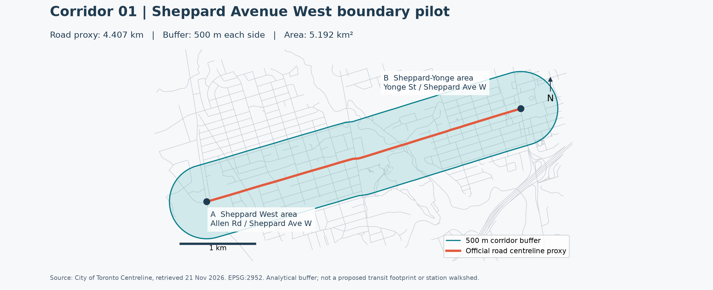

# TRUST-Line - UGCC 2026

Evidence, data preparation, reproducible code, geometry pilot and assistant handoff for the UTSRI x NRCI 2026 UGCC statistics case, "Drawing Toronto's Line of Best Fit".

## Start here

- [Latest v0.3 equity pivot and issues](outputs/project/CONTINUATION_v0.3.json)
- [Low-income pilot evidence and results](outputs/project/outputs/low_income_pilot_v0.3/review.html)
- [Original v0.1 assistant handoff](outputs/project/HANDOFF_v0.1.md)
- [Current project strategy and reproduction instructions](outputs/project/README.md)
- [Input coverage](outputs/project/data/model_input_coverage_v0.1.csv)
- [Validation status](outputs/project/outputs/validation_v0.3.json)
- [Sheppard West geometry pilot](outputs/project/outputs/sheppard_west_pilot/README.md)
- [Repository setup and upload scope](REPOSITORY_SETUP.md)

## Current status

All 24 alternatives are retained. Part 1 excludes construction costs and cost-normalized measures. Source missingness is preserved without imputation. No ranking, optimization or simulation has been run.

The five selected non-cost City score columns contain **98 of 120** published values and **22 missing cells within those five selected columns**. They are not five complete criteria. PPI is withdrawn at the user's request and replaced by `low_income_population_share_500m`. The replacement has one pilot value and 23 `pending_collection` rows. Structural validation passes, but **model_ready remains false**; no selected criterion is declared admitted just by changing status labels.

The approved primary method allocates official 2021 Census CT counts by their polygon area inside a 500 m catchment, assuming uniform population and low-income density within each CT. For corridor 01, the estimated low-income count is **4,851.75**, total population **30,491.28**, and custom low-income share **15.9119%**. The numerator uses 2020 LIM-AT status among private-household residents; the denominator includes all Census residents. The separate LIM-applicable-population comparator is **16.0012%**. These are spatial estimates, not exact observed corridor counts or official prevalence figures.

The DA comparison covers **48 DAs**, but DA `35202414` has suppressed LIM-AT counts. Its missing source values remain blank, so no complete DA low-income point estimate is reported. All 14 CT source records are complete; the user selected CT area weighting as the consistent policy for future calculations across all 24 corridors. Both CT and DA population estimates fall within the earlier DB bounds; this is a consistency check, not proof of uniformity.

The midpoint of DB population bounds is **32,679.5**. It is retained with the lower/upper bounds as a denominator-only stress scenario, holding the CT-allocated low-income numerator fixed. It is not labelled an area-weighted estimator. No ranking sensitivity or simulation has been run while the selected inputs remain incomplete.

Corridor 01, Sheppard Ave West, has an official City road-centreline proxy of **4.407 km** and a trial **500 m** buffer of **5.192 km2**. This is a geometry test, not the chosen winning corridor or an approved future transit alignment.

The v0.2 census overlay intersects **174 dissemination blocks across 14 census tracts**, with 125 blocks fully inside and 49 partially inside the trial buffer. Bounds on published census population counts are **25,300 to 40,059**. No within-block population point estimate, population weights or PPI was calculated. The official StatCan boundary data and a clearly labelled Data for Canada GAF archive are preserved with checksums. The archive's Toronto population sum matches the official City total, but its official binary checksum remains unverified. Six population-accounting and integration tests pass.

The complete competition guideline package, p.22, restricts AI use and requires disclosure. The continuation records this unresolved participation-rule issue and this session's AI assistance; no submission eligibility conclusion is made.



## Repository layout

```text
outputs/project/       Canonical project snapshot: data, code, evidence, maps and handoff
outputs/*.zip          Complete original delivery archive
outputs/               Earlier inventory exports and local convenience launcher
reference/competition/ Original user-supplied case and guideline PDFs
work/                  Historical acquisition, preparation and audit helpers/intermediates
```

The workspace layout is retained so source-relative paths remain understandable. The older extracted duplicate `outputs/TRUST_Line_project_v0.1/project` and software runtime trees are not copied into Git. Do not execute historical `work` generators without reading them; some overwrite newer data and documentation.

## Validate

From the canonical project directory:

```powershell
cd outputs/project
python -B code/validate_data.py --output outputs/validation_v0.3.json
```

Read the JSON: a zero process exit does not mean the inputs are ready for modelling. See the handoff for exact dependencies and next steps for tract-level PPI acquisition and population-weighted corridor aggregation.

For the offline census overlay, use an isolated Python environment with `outputs/project/code/requirements_census_v0.2.txt`. From `outputs/project`:

```sh
python -B code/audit_census_overlay.py --repair-invalid
python -B code/calculate_low_income_proxy.py
python -B -m unittest discover -s code -p 'test_*.py' -v
```

Archived inputs suffice for these commands. Acquisition scripts repeat public network downloads only when explicitly run. `UPLOAD_MANIFEST_v0.1.csv` and `UPLOAD_MANIFEST_v0.2.csv` describe historical uploads; `UPLOAD_MANIFEST_v0.3.csv` inventories this equity pivot. The Windows paths in the original handoff are historical; use `outputs/project` in this repository for cloud work.
